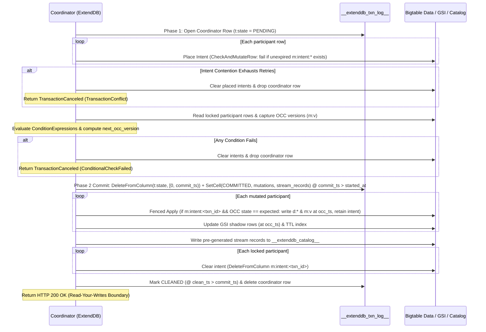

# RFC-0000: Cloud Bigtable Storage Backend for ExtendDB

- Status: Draft
- Author: @annguy3n
- Created: 2026-06-29
- Tracking issue: #185

## Summary

This RFC defines the design and implementation of a production-grade Google Cloud Bigtable storage backend (`crates/storage-bigtable`) for ExtendDB `v1.0.0`. It addresses transaction isolation and serializable read-through-log snapshots, deterministic Optimistic Concurrency Control (OCC) cell timestamps compatible with `MaxNumVersions(1)` garbage collection, fenced two-phase commit (2PC) apply, unified write-ahead fenced DynamoDB Streams emission with full disable/re-enable shard lineage (`stream_lineage`), FoundationDB tuple escape-encoded Global Secondary Index (GSI) keys and projections, sharded Time-to-Live (TTL) indexing, `SecretKeys` KEK/DEK envelope encryption and `encryption-key` lifecycle commands, IAM/metrics/rate-limit catalog conformance, gRPC transient-error classification, application-profile single-cluster routing, and Google Cloud Platform (GCP) authentication.

## Motivation

Mapping DynamoDB's API contract onto Cloud Bigtable's wide-column, single-row-atomic data model introduces several distributed-systems challenges that a production backend must resolve:

1. **Transaction Isolation & TOCTOU Races:** Naive read-modify-write conditional operations evaluate `ConditionExpression`s without atomic concurrency control, allowing concurrent writers to overwrite uncommitted state or bypass 2PC locks.
2. **Cell Timestamps vs. `MaxNumVersions(1)` Compaction:** Relying on server-assigned cell timestamps (`SetCell.timestamp_micros = -1`) allows tablet-server wall-clock differences or narrow concurrency windows to interleave cells from distinct writes across qualifiers (`d:*` vs. `m:v`), producing torn rows once `MaxNumVersions(1)` compaction runs.
3. **2PC Race Conditions (Read-then-Lock & Unfenced Apply):** Reading participant rows before placing intent locks exposes `TransactWriteItems` to TOCTOU races, while applying Phase 2 mutations unconditionally allows stalled coordinators whose intents were swept to overwrite newer committed data.
4. **Unfenced Stream Emission:** Emitting DynamoDB Stream records as an unfenced trailing write after mutating the base table loses stream records if the server crashes in the gap, violating [RFC-0003](0003-backend-acceptance-criteria.md) §3.2 and §5.1.
5. **Inefficient TTL Eviction:** Full-table scans to identify expired items degrade read throughput at scale and risk deleting items whose TTL attribute was concurrently extended.
6. **GSI Sort-Order & Consistency:** Non-terminal sort keys in composite GSI row keys suffer sort inversion unless escape-terminated, and shadow-table write failures require background reconciliation to heal base-to-shadow divergence.
7. **Multi-Cluster Routing & Auth Constraints:** Cloud Bigtable rejects `CheckAndMutateRow` under multi-cluster routing with eventual consistency unless routed via a single-cluster application profile, and enterprise deployments require explicit service-account credential configuration.

## Detailed Design

### 1. Table Mapping & Key Encoding

#### A. Table Structure & Naming
* **Catalog & Stream Ledger (`__extenddb_catalog__`):** Stores system settings (`setting:catalog_id`, `setting:encryption_key`, `setting:encryption_key_ring`), accounts, admins, IAM users/groups/roles/policies/boundaries/tags, `AKIA*` access keys and `ASIA*` STS sessions (`iam_session:<token>` + secondary index `iam_session_ak:<access_key_id>`), login rate-limit windows (`failed_login:<principal>\x00<nanos:020>:<uuid>`), minute-bucketed operational metrics (`metric:<bucket_secs:012>:<dims_sha256>`), idempotency tokens (`idem:<account_id>:<token>`), catalog migration ledger rows (`migration_ledger:catalog:<id:04>`), distributed worker leases (`lock:<name>`), stream shard lineage rows (`stream_shard:<shard_id>`), and stream records (`stream_record:<shard_id>:<seq_26>`) in column family `c` (qualifier `j`).
* **Coordinator Transaction Log (`__extenddb_txn_log__`):** Stores coordinator state (`t:state`), start timestamp (`t:started_at`), participant list (`t:participants`), pre-computed mutations (`t:mutations`), and pre-generated stream records (`t:stream_records`) in column family `t`.
* **Sharded TTL Index (`__extenddb_ttl_index__`):** Stores expiration index entries across 16 hash shards in column family `d`.
* **Data Tables (`t<table_id_16hex>`):** Each DynamoDB table maps to a dedicated Bigtable table named `t` followed by the first 16 lowercase hex characters of the table's unique `table_id` UUID (17 characters total). Deriving physical table names from `table_id` rather than `table_name` guarantees clean isolation across accounts and across `DeleteTable` + `CreateTable` name reuse ([RFC-0003](0003-backend-acceptance-criteria.md) §8.2). Data attributes live in column family `d` (one qualifier per top-level attribute); OCC row versions (`m:v`) and 2PC intent locks (`m:intent:<txn_id>`) live in column family `m`; column family `t` is reserved.
* **GSI Shadow Tables (`t<table_id_16hex>_g<idx_hash_8hex>`):** Each GSI maps to a shadow Bigtable table where `idx_hash_8hex` is the 8-character hex FNV-1a hash of `index_name` (27 characters total, well within Cloud Bigtable's 50-character table-ID limit).

#### B. Exact Decimal & Order-Preserving Key Encoding
Cloud Bigtable sorts row keys by unsigned raw byte lexicographical order and enforces a **4 KiB (4096-byte)** row-key limit, validated upfront in `row_key::encode_key` and `gsi::shadow_row_key_for_item`.

Base-table row keys follow:
```text
Composite Key: [pk_tag:1] [pk_len:u32BE:4] [pk_bytes] [sk_tag:1] [sk_bytes]
PK-Only Key:   [pk_tag:1] [pk_len:u32BE:4] [pk_bytes]
```
Where `pk_tag` and `sk_tag` identify the DynamoDB scalar type (`0x53` for `S`, `0x4E` for `N`, `0x42` for `B`).

* **Partition (`HASH`) Keys:** Length-prefixed (`[pk_len:u32BE:4]`) before `[pk_bytes]` so variable-length partition keys cannot collide across boundaries and all items sharing a partition key sort contiguously. Parallel scan segment assignment hashes the `[pk_tag:1][pk_len:4][pk_bytes]` prefix with CRC32 (`crc32(pk_prefix) % total_segments`), shared identically between `QueryScan::scan` and `DataEngine::scan_key_in_segment`.
* **Sort (`RANGE`) Keys:** Stored as raw order-preserving bytes **without** a length prefix on terminal segments so string and binary sort keys compare in unsigned byte-lexicographic order regardless of length.
* **Exact 38-Digit Decimal `N` Encoding (`encoding::number`):** DynamoDB numbers support up to 38 significant digits over scientific exponents `[-130, +125]`. Numbers are normalized (stripping leading/trailing zeros and collapsing `-0` / `0.0` to canonical zero) and encoded without floating-point conversion:
  * **Negative (`value < 0`):** Sign byte `0x00`, inverted biased exponent `0xFF - (sci_exp + 130)`, and 38 digit bytes inverted as `9 - digit` (padded with `0x09` so shorter magnitudes compare greater / closer to zero).
  * **Zero (`value == 0`):** Single byte `[0x80]`.
  * **Positive (`value > 0`):** Sign byte `0xFF`, biased exponent `(sci_exp + 130) as u8`, and 38 digit bytes `0..=9` (padded with `0x00`).
  * Inputs exceeding 38 significant digits or exponent bounds `[-130, 125]` are rejected at write/query time with `ValidationException`.
* **GSI Shadow Row Keys (`gsi::shadow_row_key_for_item`):**
  ```text
  GSI Composite Key: [gsi_pk_tag:1] [gsi_pk_len:u32BE:4] [gsi_pk_bytes]
                     [gsi_sk_tag:1] [escape_encoded(gsi_sk_bytes)] [0x00 0x00]
                     [base_pk_tag:1] [base_pk_len:u32BE:4] [base_pk_bytes]
                     [base_sk_tag:1] [base_sk_bytes]
  ```
  * **Non-Terminal Sort Key Escape Encoding (`gsi_sk`):** Every `0x00` byte in `gsi_sk_bytes` is escaped as `0x00 0xFF` and terminated by `0x00 0x00` (FoundationDB tuple encoding). Without termination, the following `base_pk_tag` byte (e.g., `0x53`) would participate in sort-key comparison and invert ordering (e.g., `"A"` sorting after `"AB"` because `0x53 > 0x42`).
  * **Terminal Sort Key (`base_sk`):** Remains raw order-preserving bytes to the end of the row key.

### 2. Transaction Rules, Deterministic OCC Timestamps & Isolation Guarantees

#### A. Transaction Validation & Idempotency Rules
* **`ClientRequestToken` Idempotency:** `TransactWriteItems` scopes idempotency keys by `(account_id, token)` (`idem:<account_id>:<token>`) over a 10-minute window and derives a deterministic coordinator ID `SHA-256(account_id || ":" || token)`. Replays with matching operation fingerprints return `IdempotentReplay` (rolling forward first if the coordinator row is `COMMITTED`); mismatched payloads return `IdempotentMismatch`.
* **Duplicate Participant Rejection:** Any `TransactWriteItems` request targeting the same `(data_table, row_key)` more than once is rejected upfront with `ValidationException`.

#### B. Lock-then-Read Coordinator 2PC Flow
`TransactWriteItems` acquires per-row intents *before* reading participant rows and evaluating condition expressions, commits atomically in `__extenddb_txn_log__`, applies mutations via fenced `CheckAndMutateRow`, and acknowledges HTTP 200 OK only after Phase 2 mutations and stream records are durable:



#### C. Read Isolation & `TransactGetItems` Read-Through-Log Rule
* **Read-Your-Writes Acknowledgment Boundary:** Success is returned only after Phase 2 mutations are applied to column family `d` and GSI shadow tables, guaranteeing `ConsistentRead = true` (`GetItem`, `Query`, `Scan`) and `TransactGetItems` immediately observe the committed state.
* **Read Committed (No Dirty Reads):** Uncommitted transactions write only `m:intent:<txn_id>` in family `m`. Standard reads filter strictly on family `d` (`Chain([FamilyNameRegexFilter("^d$"), CellsPerColumnLimitFilter(1)])`) and never observe uncommitted writes.
* **ABA-Safe Fenced Phase 2 Apply & Intent Retention:** `TxnCoordinator::apply_fenced_mutation` predicates its `CheckAndMutateRow` via an outer `Filter::Condition` asserting **both** `m:intent:<txn_id>` presence (`exact_re2_bytes`) **and** the 3-case `(expected_version, row_existed)` OCC state guard (`(Some(v), _) -> m:v == v`; `(None, false) -> neither m:v nor d:* exists`; `(None, true) -> d:* exists && m:v absent`). Checking `(expected_version, row_existed)` guarantees that even if an intent lease expires and a newer writer advances `m:v` to `v2`, neither a slow coordinator nor `sweeper::roll_forward` can overwrite `v2` on the base row or apply superseded GSI shadow mutations (which `roll_forward` gates on `applied || cur_ver == Some(new_version)`). Furthermore, `m:intent:<txn_id>` is retained across base-row apply, GSI shadow updates, TTL index updates, and stream ledger persistence, and cleared via `clear_intent` only after stream records land.
* **Serializable `TransactGetItems` (Read-Through-Log Snapshot Rule):** `TransactGetItems` reads family `d` alongside any unexpired `m:intent:<txn_id>` cell (`ItemOps::batch_get_with_intent_check`) and resolves active intents via `TxnCoordinator::get_state`:
  * **Intent Present & Coordinator `COMMITTED`:** Serves the committed post-image (`Some(item)` for `Put`, `None` for `Delete`) directly from `t:mutations` in `__extenddb_txn_log__`, even if Phase 2 apply has not yet reached that participant row.
  * **Intent Present & Coordinator `PENDING` / `ABORTED` / `CLEANED` (or No Active Intent):** Serves the current committed image from family `d`.
  * **Lazy Compaction Filter & Rank-Ordered Coordinator Timestamps:** Because Cloud Bigtable enforces `MaxNumVersions(1)` asynchronously during compaction, `TxnCoordinator::get_state` and `sweeper::sweep_once` **must** read `__extenddb_txn_log__` with `Chain([FamilyNameRegexFilter("^t$"), CellsPerColumnLimitFilter(1)])`. Coordinator transitions allocate millisecond-aligned timestamps via `monotonic_timestamp_after_micros(exclusive_floor_micros)` (`PENDING` at `t0 >= now`, `ABORTED`/`COMMITTED` at `t1 > t0`, `CLEANED` at `t2 > t1`) preceded by bounded `DeleteFromColumn(t:state, [0, ts_micros))`. Anchoring to wall-clock time while enforcing `ts > floor` guarantees `COMMITTED` strictly dominates `PENDING` across multi-node NTP skew and ensures retried `ClientRequestToken`s (`SHA-256(account_id || ":" || token)`) after a Phase 1 abort (`DeleteFromRow`) always stamp cells above the prior delete marker.

#### D. Deterministic OCC-Derived Cell Timestamps & Single-Row Concurrency Control
Using server-assigned cell timestamps (`timestamp_micros: -1`) is unsafe under `MaxNumVersions(1)`: if two writers pass filters within a narrow window, or tablet servers experience slight clock skew across tablet moves or recovery roll-forward, `MaxNumVersions(1)` compaction retains whichever cell had the higher wall-clock arrival timestamp per qualifier rather than the higher logical OCC version, risking torn rows (`d:*` from one write paired with `m:v` or attributes from another).

To eliminate torn rows while satisfying Cloud Bigtable's **`TimestampGranularity::MILLIS`** rule (which rejects explicit `SetCell.timestamp_micros` values not divisible by `1_000` with `INVALID_ARGUMENT`), all row writes derive deterministic millisecond-aligned cell timestamps directly from the monotonic OCC version:

* **Hybrid Monotonic OCC Version (`item_ops::next_occ_version`):**
  * `now_ms = unix_timestamp_millis().max(1)`
  * `next_occ_version(None) = now_ms`
  * `next_occ_version(Some(prev)) = prev.max(now_ms) + 1`
  * `version_to_timestamp_micros(v) = (v * 1_000) as i64`
* **Uniform Row-Wide Stamping:** Every `SetCell` in a write—every attribute cell in `d:*`, the `m:v` version cell (preceded by bounded `DeleteFromColumn(m:v, [0, occ_ts))`), and every projected cell in GSI shadow tables—is stamped with the exact same `version_to_timestamp_micros(next_version)`. Bounding `DeleteFromColumn` to `[0, occ_ts)` clears historical versions without creating an unbounded tombstone that could mask future writes, and a higher OCC version strictly dominates all cells of every prior write across all column families even across dozens of sequential writes within the same wall-clock millisecond.
* **Monotonic Tombstone Versioning on Delete:** Deleting an existing row (`expected_version = Some(v)`) issues `DeleteFromFamily("d")`, bounded `DeleteFromColumn("m", "v", [0, occ_ts))`, and `SetCell("m", "v", next_version)` at `version_to_timestamp_micros(next_version)`. Retaining the monotonic `m:v` marker across deletes prevents ABA version reuse and timestamp regression on rapid `Put -> Delete -> Put` cycles, while `Query`, `Scan`, and `BatchGetItem` filter on `FamilyNameRegexFilter("^d$")` so version-only tombstones never appear as items or consume `rows_limit`.
* **De Morgan OCC CAS & Retry Loop (`select_occ_predicate`):** Because Bigtable row filters have no boolean `NOT` operator, `ItemOps::put_cas` and `ItemOps::delete_cas` express OCC guards in De Morgan conflict form with mutations in `false_mutations`:
  * **Versioned Existing Row (`read_version = Some(v)`):** Predicate matches if `(unexpired m:intent:* exists) OR (m:v != v)`.
  * **Unversioned Pre-Existing Row (`read_version = None, row_existed = true`):** Predicate matches if `(unexpired m:intent:* exists) OR (m:v exists)`, allowing any legacy/unversioned row to transition onto monotonic `m:v` versioning on its first write while still rejecting concurrent writers that stamped `m:v` first.
  * **New Row (`read_version = None, row_existed = false`):** Predicate matches if `(unexpired m:intent:* exists) OR (m:v exists) OR (d:* exists)`.
  * **Conflict Classification & Contention Retry:** When `predicate_matched == true`, `ItemOps` checks `has_active_intent(row_key)`. If an unexpired 2PC intent holds the row, it immediately returns `StorageError::TransactionConflict` (`TransactionConflictException`, [RFC-0003](0003-backend-acceptance-criteria.md) §4.3). Otherwise, it returns `CasOutcome::OccMismatch` and `BigtableEngine` retries up to `MAX_OCC_ATTEMPTS` (16) with jittered exponential backoff—re-reading the row, re-evaluating `ConditionExpression` (so concurrent conditional losers deterministically receive `ConditionFailed` per §4.2), and re-applying `UpdateAction`s (so concurrent `UpdateItem` increments serialize cumulatively with zero lost updates per §4.4).

#### E. Cloud Bigtable App Profile & Single-Cluster Routing Requirements
Cloud Bigtable requires single-cluster routing (or multi-cluster routing with single-row transactions enabled) to execute `CheckAndMutateRow`. Multi-cluster profiles with eventual consistency reject `CheckAndMutateRow` with `FailedPrecondition`. `BigtableStorageConfig` exposes `app_profile_id` and forwards it on every `ReadRows`, `MutateRow`, `MutateRows`, and `CheckAndMutateRow` RPC so multi-cluster deployments can bind ExtendDB to a single-cluster profile.

#### F. Garbage Collection (GC) Rules & Recovery Sweeper
* **Column Family GC:** `d` and `m` on data/GSI tables, `c` on `__extenddb_catalog__`, `t` on `__extenddb_txn_log__`, and `d` on `__extenddb_ttl_index__` are provisioned with `MaxNumVersions(1)`.
* **2PC Recovery Sweeper (`sweeper.rs`):** Spawned via `BigtableRuntimeHooks::spawn_workers` under a distributed catalog lease (`lock:sweeper`) with graceful `CancellationToken` shutdown. Transactions in `__extenddb_txn_log__` older than `intent_timeout_secs` are rolled back if `PENDING`/`ABORTED` (clearing intents and deleting the coordinator row) or rolled forward idempotently if `COMMITTED` (re-running fenced base mutations, GSI shadow writes, and idempotent stream record writes before marking `CLEANED` and dropping the coordinator row).

### 3. Unified Fenced DynamoDB Streams Architecture & Stream Lineage

#### A. Write-Ahead Fenced Stream Emission & Labelled Shard Lineage (`stream_lineage`)
To satisfy [RFC-0003](0003-backend-acceptance-criteria.md) §3.2 and §5.1 ("a crash between a committed data write and its stream record insert must not be possible"), stream emission is **never** performed as an unfenced trailing write. Whenever a caller supplies `stream: Some(&StreamCapture)` on a table whose `StreamSpecification.stream_enabled` is active (`active_stream_target_for_capture`), single-item writes (`PutItem`, `UpdateItem`, `DeleteItem`—including TTL sweeper deletions) execute through `BigtableEngine::execute_fenced_single_item_write`, sharing the exact same `__extenddb_txn_log__` commit fence as `TransactWriteItems` (while `DataEngine` writes with `stream: None`—such as `ImportTable` bulk imports—preserve the upstream stream-suppression contract without emitting stream events):

1. **Labelled 4-Shard Stream Lineage (`extenddb_storage::stream_lineage`):** Each stream enablement (`CreateTable` or `UpdateTable`) allocates a monotonic stream label via `stream_lineage::next_stream_label` and provisions `SHARDS_PER_STREAM` (`4`) open `ShardMeta` rows (`00..03`) in `__extenddb_catalog__` at `stream_shard:<shard_id>`, where `shard_id = shardId-{table_id}-{label_millis:013}{view_digit:1}{index:02}` (61 characters, within the 65-character AWS SDK `ShardId` limit). Writes and `StreamEngine::assign_shard` route partition keys deterministically across open shards via `crc32fast::hash(pk_text.as_bytes()) % open.len()`, preserving strict per-item causal ordering while matching `SqliteEngine`'s shard fan-out. Disabling a stream stamps `ending_sequence_number` on all open shards while retaining `LatestStreamArn`, `LatestStreamLabel`, and closed shard/record history so disabled streams remain describable, listed by `ListStreams`, and readable under their original ARN while rejecting cross-stream `(newer_arn, older_shard_id)` pairings (`SHARD_DOES_NOT_EXIST` / `STREAM_DOES_NOT_EXIST`).
2. **Lock & Read:** Open a coordinator row (`PENDING`) in `__extenddb_txn_log__`, place `m:intent:<txn_id>` on the target row (retrying transient single-row intent contention), read the locked pre-image and `m:v`, and evaluate `ConditionExpression` (plus `removes_only` no-op detection on missing items for `UpdateItem`). On failure or no-op, clear the intent and drop the coordinator row without writing data or stream records.
3. **Sequence Allocation & Record Construction (`streams.rs`):** Allocate a fixed-width **26-digit decimal sequence number** (`{epoch_ms:013}{counter:09}{node_suffix:04}`, `StreamEngine::sequence_number_width() == 26`) that is strictly monotonic, lexicographically ordered, and parseable as `u128` for `AT_SEQUENCE_NUMBER` shard-iterator arithmetic in `extenddb-engine`. Build the `StreamRecord` (`INSERT`, `MODIFY`, or `REMOVE`) honoring `StreamCapture` (`view_type`, `region`, and optional TTL `user_identity`), suppressing no-op `MODIFY` events when `old_image == new_image`.
4. **Atomic Commit Point:** Write `COMMITTED` to `__extenddb_txn_log__` together with `t:mutations` and `t:stream_records` (carrying `(stream_arn, shard_id, record)`) *before* mutating column family `d`.
5. **Fenced Apply & Idempotent Ledger Write:** Apply the fenced `CheckAndMutateRow` mutation to the base table, update GSI shadow tables and TTL index entries, and persist each stream record to `__extenddb_catalog__` at deterministic row key `stream_record:<shard_id>:<seq_26>`. Mark `CLEANED` and drop the coordinator row only after `streams::write_record` succeeds.
6. **Crash Recovery Idempotency:** If ExtendDB crashes after `COMMITTED` (before base-row apply or before `streams::write_record`), `TransactGetItems` immediately serves the committed post-image via the read-through-log rule, and `sweeper::sweep_once` rolls forward both the fenced data write and `streams::write_record`. Because the stream ledger row key is deterministic on `(shard_id, sequence_number)`, re-running `roll_forward` overwrites the identical JSON payload with zero duplicate stream records.

#### B. Why the `__extenddb_catalog__` Table Ledger Beats Cloud Bigtable Native Change Streams
Cloud Bigtable offers a native Change Streams CDC feature (`ReadChangeStream`), which we evaluated and deliberately rejected in favor of the coordinator-fenced `__extenddb_catalog__` stream ledger for five architectural reasons:

1. **Transactional Commit Gating:** Bigtable Change Streams emit low-level per-row storage mutations immediately upon `MutateRow` / `CheckAndMutateRow` without awareness of `__extenddb_txn_log__`. Intent placements (`m:intent:<txn_id>`), rolled-back intents, or multi-table 2PC writes in progress would require a complex stateful stream-join consumer to buffer and filter against coordinator state.
2. **Item-Level `StreamViewType` Fidelity:** DynamoDB Streams require complete item-level `OldImage` and `NewImage` projections (`KEYS_ONLY`, `NEW_IMAGE`, `OLD_IMAGE`, `NEW_AND_OLD_IMAGES`) and exact `INSERT` vs. `MODIFY` vs. `REMOVE` classification. Bigtable Change Streams emit cell-level deltas (`SetCell`, `DeleteFromColumn`, `DeleteFromFamily`) and do not materialize prior full-row item images on partial updates or deletes.
3. **Shard Stability & `u128` Sequence-Number Contract:** Bigtable Change Streams dynamically split and merge tablet partitions and address positions via opaque `ChangeStreamContinuationToken`s, which cannot satisfy DynamoDB's stable shard topology, `u128`-parseable decimal `SequenceNumber` ordering (`AT_SEQUENCE_NUMBER` / `AFTER_SEQUENCE_NUMBER`), or 15-minute `ShardIterator` semantics.
4. **TTL Service `UserIdentity` Attribution:** DynamoDB requires TTL deletions to carry `userIdentity = { type: "Service", principalId: "dynamodb.amazonaws.com" }`. Native storage-level CDC carries no application caller or TTL service identity metadata.
5. **Hermetic Emulator & Zero-Admin Portability:** The official `cbtemulator` does not implement `ReadChangeStream`, whereas the `__extenddb_catalog__` ledger runs identically in hermetic CI (`cbtemulator`) and production GCP without requiring separate change-stream retention DDL on every user table.

### 4. Scalable TTL Indexing & Fenced Expiration

#### A. Sharded TTL Index Schema (`__extenddb_ttl_index__`)
* **Row Key Binary Layout:** `[shard_id:1] [expiry_epoch_secs_be:i64:8] [account_id_len:1] [account_id] [table_name_len:1] [table_name] [encoded_base_row_key]`
  * `shard_id = fnv1a(base_row_key) % 16` distributes writes and sweeps evenly across 16 prefixes instead of creating a monotonic timestamp hotspot.
  * `expiry_epoch_secs_be` orders entries chronologically within each shard so each sweep reads only `[shard_id || 0, shard_id || (now + 1))`.
* **Write Maintenance:** `PutItem`, `UpdateItem`, `DeleteItem`, and `TransactWriteItems` parse TTL attributes via `parse_ttl_epoch_secs` (supporting integer, fractional, and scientific `AttributeValue::N` strings via `bigdecimal` while treating `<= 0` as non-expiring per DynamoDB semantics), removing stale TTL index keys when a prior item's TTL attribute changes or is deleted and inserting a new TTL index row when the post-image carries a positive numeric TTL epoch.

#### B. Live Verification, Metrics & Fenced TTL Stream Emission (`ttl_worker.rs`)
1. Under the distributed `lock:ttl_worker` catalog lease, scan `[shard || 0, shard || (now + 1))` across all 16 shards.
2. Confirm the table still exists and has `TimeToLiveStatus::Enabled`. If the table was dropped or TTL was disabled, delete the stale index row without touching base data.
3. Read the live base item (`DataEngine::get_item`) and verify its current TTL attribute (`parse_ttl_epoch_secs`) still equals the index row's `expiry` (`> 0` and `<= now`). If the item was already deleted or updated to a later or non-positive expiration timestamp, delete **only** the stale TTL index entry.
4. Issue `DataEngine::delete_item` with a `#ttl = :ttl_exp` `ConditionExpression` guard (preventing a race if a client extends TTL between step 3 and step 4) and, when streams are enabled on the table, a `StreamCapture` carrying `UserIdentity { principal_id: "dynamodb.amazonaws.com", identity_type: "Service" }`, recording `TimeToLiveDeletedItemCount` and `TtlStalenessSeconds` in `MetricsCollector`. Because stream-enabled `delete_item` executes through `execute_fenced_single_item_write`, the base-row deletion and TTL `REMOVE` stream record are atomically fenced in `__extenddb_txn_log__`.

### 5. Query, Scan & GSI Consistency

* **Query Direction & `cbtemulator` Compatibility (`query_scan.rs`):** Forward and reverse `Query` calls (`ScanIndexForward`) construct tight byte-range bounds over `[pk_prefix, pk_upper]` (merging `ExclusiveStartKey` into the active sort-key range bound so `BETWEEN` and `begins_with` never lose their upper/lower bounds across pages, [RFC-0003](0003-backend-acceptance-criteria.md) §2.6, and short-circuiting inverted/empty bounds such as `BETWEEN :hi AND :lo` where `:hi > :lo` before issuing an RPC). Production Cloud Bigtable executes descending queries server-side via `ReadRowsRequest { reversed: true }`; when running against `cbtemulator` (which returns `UNIMPLEMENTED` or `FAILED_PRECONDITION` for `reversed: true`), `QueryScan::query` automatically falls back to a bounded partition scan plus in-memory reversal with identical `LastEvaluatedKey` semantics.
* **Exact `LastEvaluatedKey` & Parallel Scan Completeness:** Both `Query` and `Scan` fetch `limit + 1` storage rows so `LastEvaluatedKey` is emitted if and only if unread items remain in the range ([RFC-0003](0003-backend-acceptance-criteria.md) §7.2). Parallel scans (`total_segments > 1`) page through storage in chunks until `limit + 1` in-segment items (`crc32(pk_prefix) % total_segments == segment`) are collected or the table exhausts, avoiding premature segment termination under key skew (§7.3).
* **GSI Projections, Key Validation & TOCTOU-Safe Background Reconciler (`gsi.rs`, `gsi_worker.rs`):** `PutItem`, `UpdateItem`, and `TransactWriteItems` validate GSI/LSI key scalar types and non-emptiness upfront (`validate_index_keys`, `validate_index_key_literal_operands`, `validate_index_key_types_after_update`) and validate `UpdateAction` operands prior to `removes_only` missing-item short-circuits (`#478`). Shadow writes synchronously project `ALL`, `KEYS_ONLY`, or `INCLUDE` attributes at the base write's deterministic OCC timestamp. `gsi_worker::run` periodically scans shadow-to-base and base-to-shadow (using pre-encoded composite shadow keys via `ItemOps::batch_get_by_raw_keys`) under `lock:gsi_reconciler`; whenever divergence is detected, it atomically re-reads `(fresh_base_row, fresh_ver)` via `ItemOps::get_with_version` and stamps repaired GSI shadow cells at `version_to_timestamp_micros(fresh_ver)` so concurrent base updates are never masked by wall-clock timestamps.

### 6. GCP Connectivity, Secret Key Ring, Catalog Stores & Error Classification

```toml
[storage.bigtable]
project_id = "my-gcp-project"
instance_id = "my-bt-instance"
data_instance_id = "my-bt-data-instance"  # Optional: separate catalog and data instances
app_profile_id = "single-cluster-profile" # Recommended: single-cluster routing for CheckAndMutateRow
credentials_path = "/etc/extenddb/sa.json" # Optional: explicit GCP service-account JSON key
# emulator_host = "127.0.0.1:8086"        # Optional: local cbtemulator endpoint
pool_size = 20
catalog_pool_size = 8
sweeper_cadence_secs = 30
intent_timeout_secs = 60
ttl_scan_cadence_secs = 60
gsi_reconcile_cadence_secs = 300
```

* **Safe Client Construction & Split-Instance Isolation (`data/client.rs`):** `BigtableClient::connect` builds emulator connections via `BigTableConnection::new_with_emulator` and explicit service-account connections via `gcp_auth::CustomServiceAccount::from_file` + `BigTableConnection::new_with_token_provider` without any `unsafe` process-environment mutation (`std::env::set_var`) or `Box::leak` allocations. When `data_instance_id` differs from `instance_id`, catalog tables, distributed worker leases (`lock:*`), and stream ledger records stay strictly on `instance_id` (`catalog_client` sized by `catalog_pool_size`) while user data tables, GSI shadow tables, `__extenddb_txn_log__`, and `__extenddb_ttl_index__` live strictly on `data_instance_id` (`data_client` sized by `pool_size`).
* **Thin-Binary Compile-Time Registration (`default = ["postgres"]` Preserved):** `crates/bin` preserves `default = ["postgres"]` so standard `cargo build` / `cargo check` invocations work unchanged, while exposing a mutually exclusive `bigtable` Cargo feature (`cargo build --no-default-features --features bigtable`) that installs `extenddb_storage_bigtable::backend()` via `extenddb_storage::set_backend` with zero edits to `crates/core`, `crates/engine`, `crates/auth`, or `crates/server`.
* **At-Rest Secret Encryption & KEK/DEK Key Ring (`extenddb_storage::secret_keys`):** `m0001_baseline` seeds a unique `setting:catalog_id` UUID, and `BigtableCatalogStore` / `BigtableCredentialStore` encrypt and decrypt `AKIA*` access-key secrets and `ASIA*` STS session secrets via `SecretKeys` (`SecretRow::access_key` and `SecretRow::session` AAD binding `(table, access_key_id, account_id, principal, session_name, expires_at)`). `SettingsStore::replace_setting` uses single-row `CheckAndMutateRow` compare-and-swap (`Catalog::compare_and_swap_raw` / `put_if_absent`), and `ManagementStore` implements cursor-paged `read_secret_page`, `write_secrets`, `delete_secrets`, and `delete_setting` to support `extenddb encryption-key switch`, `rotate`, `rewrap`, and `reset`.
* **IAM Leftover Hygiene, Operational Metrics & Login Rate Limiting (`catalog_store.rs`):** Deleting or creating a user, group, role, or account atomically purges associated policies, permission boundaries, tags, memberships, access keys, and `failed_login:<account_id>/` rate-limit entries (`iam_leftovers_conformance`). `MetricsStore` accumulates minute-bucketed metrics keyed by `metric:<bucket_secs:012>:<dims_sha256>` via CAS retry and supports retention pruning (`metrics_conformance`).
* **Frozen Baseline & Additive Migration Ledger (`m0001_baseline.rs`, `migrations.rs`):** `m0001_baseline.rs` (`#[rustfmt::skip]`) provisions `__extenddb_catalog__`, `__extenddb_txn_log__`, and `__extenddb_ttl_index__` plus `setting:catalog_id`; `MigrationId`s `2..=12` record cleanly as schema-less no-ops in `migration_ledger:catalog:<id:04>` under `lock:catalog_migrations`.
* **gRPC Transient Error Classification (`data/client.rs`):** Data-plane and catalog errors are classified via `map_bigtable_err`, `map_catalog_err`, and `classify_grpc_status`:
  * `Unavailable`, `DeadlineExceeded`, `Aborted`, `ResourceExhausted`, RPC timeouts, and transient I/O errors map to `StorageError::Transient` (surfaced by the server as retryable HTTP 503 `ServiceUnavailable` rather than opaque HTTP 500s).
  * Transport connection failures map to `StorageError::Connection`.
  * `InvalidArgument` and `OutOfRange` map to `StorageError::Validation` (HTTP 400).
  * `Unimplemented` maps to `StorageError::Unsupported` (HTTP 400).

### 7. Backup, Snapshot, Restore & Point-in-Time Recovery

* **Explicit `StorageError::Unsupported` Refusal (`backup_stubs.rs`):** Cloud Bigtable does not provide cross-table point-in-time snapshot reads on the data plane, and GCP-native Cloud Bigtable Backups operate asynchronously through the GCP Admin API rather than ExtendDB's logical/store-backed backup format. `BigtableEngine` implements `SnapshotEngine`, `LegacyBackupReader`, `BackupCatalog`, and `RestoreEngine` by returning `StorageError::Unsupported` on all user-facing backup, snapshot, and restore operations (`CreateBackup`, `DescribeBackup`, `ListBackups`, `DeleteBackup`, `RestoreTableFromBackup`), which `extenddb-engine` maps cleanly to `ValidationException` (HTTP 400) rather than `InternalServerError` (HTTP 500). Passive background `BackupReconciler` queries (`check_maintenance_claim`, `list_dead_restore_jobs`, `abandoned_creating_backups`, `list_backup_rows`) return empty `Ok` results so `extenddb serve` runs cleanly without log noise.
* **Point-in-Time Recovery (`#335`):** `DescribeContinuousBackups`, `UpdateContinuousBackups`, and `RestoreTableToPointInTime` are owned directly by `extenddb-engine`, consulting `BigtableEngine::describe_table` solely for table existence.

### 8. Deliverables & Trait Conformance Matrix

Per [RFC-0002](0002-backend-plugin-policy.md) and [RFC-0003](0003-backend-acceptance-criteria.md), `crates/storage-bigtable` implements the full ExtendDB `v1.0.0` backend surface as follows:

| Trait / Subsystem | Classification | Status | Implementation Module | Notes |
|---|---|---|---|---|
| `TableEngine` | Mandatory (Data/Control) | Implemented | `src/engine.rs` | `CreateTable`, `DeleteTable`, `DescribeTable`, `ListTables`, `UpdateTable` (with 4-shard `stream_lineage` transitions), `table_key_info`, `index_info`, `index_info_by_table_id` |
| `DataEngine` | Mandatory (Data Plane) | Implemented | `src/engine.rs`, `src/data/` | OCC CAS `PutItem`/`UpdateItem`/`DeleteItem` with deterministic `occ_version * 1000` timestamps, `GetItem`, `Query`, `Scan`, `scan_key_in_segment`, ABA-fenced 2PC `TransactWriteItems`, read-through-log `TransactGetItems` |
| `VectorSearchEngine` | Optional (`as_vector_search`) | Opted out (`None`) | `src/engine.rs` | Engine rejects vector index DDL and `SearchVectors` upfront |
| `MetadataEngine` | Optional (TTL & Tags) | Implemented | `src/engine.rs`, `src/ttl_worker.rs` | Resource tagging (`TagResource`/`UntagResource`/`ListTagsOfResource`) + 16-shard `__extenddb_ttl_index__` with `parse_ttl_epoch_secs` |
| `StreamEngine` | Optional (Streams) | Implemented | `src/engine.rs`, `src/streams.rs` | Fenced write-ahead single-item, TTL, and 2PC streams; 4-shard CRC32 partition-key routing + `stream_lineage` disable/re-enable history; 26-digit `u128` decimal sequence numbers |
| `WorkerStore` | Optional (Lifecycle) | Implemented | `src/engine.rs` | Inline `ACTIVE` table creation (`process_control_plane_transitions` no-op) |
| `SnapshotEngine`, `BackupCatalog`, `LegacyBackupReader`, `RestoreEngine` | Optional (Backup/Restore) | Explicit Refusal | `src/backup_stubs.rs` | User operations return `StorageError::Unsupported` (`ValidationException` HTTP 400); passive reconciler probes return empty `Ok` |
| `ManagementStore`, `AdminStore`, `PasswordHashStore` | Mandatory (IAM & Admin) | Implemented | `src/catalog_store.rs` | Accounts, admins, IAM users/groups/roles/policies/boundaries/tags, STS sessions, password-hash persistence, `SecretKeys` KEK/DEK paging & rotation |
| `AuthorizationStore` | Mandatory (Authz) | Implemented | `src/catalog_store.rs` | User/group/role policies, permission boundaries, resource/principal tags, RFC 3339 `created_at` |
| `SettingsStore`, `MetricsStore`, `RateLimitStore`, `DiagnosticsStore` | Infrastructure / Management | Implemented | `src/catalog_store.rs` | CAS `replace_setting`, SHA-256 dimension metrics accumulation/pruning, failed-login rate-limit store, table/index diagnostics |
| `CredentialStore` | Mandatory (`SigV4` Auth) | Implemented | `src/catalog_store.rs` | `AKIA*` + `ASIA*` `SecretKeys` decryption with `SecretRow` AAD, `ExpiredTokenException`, and inactive-key S-5 propagation |
| `Bootstrapper` | Mandatory (`extenddb init`) | Implemented | `src/bootstrapper.rs` | Idempotent catalog/key/account/admin bootstrap (`catalog_key_present`, `data_connection_present`) and `destroy` cleanup |
| `CatalogMigrations` & `MigrationBackend` | Mandatory (`extenddb migrate`) | Implemented | `src/migrations.rs`, `src/m0001_baseline.rs` | Exhaustive `MigrationId` 1..=12 coverage, frozen `m0001_baseline.rs` checksum, `lock:catalog_migrations` lease |
| `OperationsEngine` | Mandatory (CLI) | Implemented | `src/operations.rs` | Connection URL parsing, identifier validation, sensitive-key redaction |
| `ServerRuntimeHooks` | Mandatory (Workers) | Implemented | `src/runtime_hooks.rs` | Spawns 6 lease-guarded workers (`ttl_worker` with metrics, 2PC `sweeper`, `gsi_reconciler`, 24h `stream_record_cleanup`, 10m `idempotency_token_cleanup`, 5m `table_size_refresh`) with `CancellationToken` shutdown |

## Testing Strategy

1. **Pure Unit Tests (`cargo test -p extenddb-storage-bigtable --lib`):**
   * Exact 38-digit decimal `N` encoding/decoding, zero normalization, and full-spectrum lexicographic order (`number.rs`).
   * Row-key 4 KiB limit enforcement, partition length prefixing, raw terminal sort-key ordering, and FDB escape-encoded GSI sort-key roundtrips (`row_key.rs`, `gsi.rs`, `ttl_key.rs`).
   * Monotonic millisecond-aligned OCC version generation (`next_occ_version`, `version_to_timestamp_micros`), `parse_ttl_epoch_secs` decimal/zero/negative parsing, 3-case De Morgan `select_occ_predicate` and ABA-safe `build_fenced_apply_predicate` `RowFilter` construction (`item_ops.rs`, `transact.rs`), RE2 metacharacter escaping and `monotonic_timestamp_after_micros` (`client.rs`), URL-encoded query parameter / TOML / `string_coerce` env-var config roundtripping (`config.rs`, `bootstrapper.rs`), 26-digit `u128` stream sequence numbers and TTL `UserIdentity` propagation (`streams.rs`), gRPC transient error mapping (`client.rs`), `check_released` migration checksum invariants (`migrations.rs`), and `StorageError::Unsupported` backup/snapshot/restore stubs (`backup_stubs.rs`).
2. **Live Bigtable Emulator Integration & Conformance Suite (`tests/emulator_integration.rs` against `cbtemulator`):**
   * Catalog bootstrap, `BigtableCatalogMigrations` baseline run, table DDL lifecycle, and split catalog-vs-data instance (`data_instance_id != instance_id`) isolation across `BigtableBootstrapper` and background workers (`sweeper`, `ttl_worker`, `gsi_worker`).
   * Guarded single-row CRUD, `ConditionExpression` evaluation, arithmetic `UpdateItem`, `removes_only` missing-item no-ops, and `#478` invalid-operand rejection on missing items.
   * Deterministic OCC cell timestamps (`m:v * 1000` shared across all cells), post-`DeleteItem` `m:v` tombstone retention and rapid re-insert monotonicity, concurrent 10-way `UpdateItem` counter increments (zero lost updates), and 8-way conditional `PutItem` races (1 winner, 7 `ConditionFailed`).
   * Multi-table 2PC `TransactWriteItems`, atomic condition-failure rollback, reused `ClientRequestToken` tombstone safety after Phase 1 abort, post-lease-expiry ABA fencing across base and GSI shadow rows, idempotency replay/mismatch, and concurrent `TransactGetItems` read-through-log verification (`COMMITTED` vs. `PENDING`).
   * Fenced single-item stream emission (`INSERT`/`MODIFY`/`REMOVE`) across `SHARDS_PER_STREAM` (`4`) CRC32-routed shards, `ImportTable` `stream: None` bulk-import suppression, post-`COMMITTED` crash recovery and pre-`COMMITTED` crash rollback via `sweeper::sweep_with_cutoff_override` without duplicates or phantom records, and full stream disable/re-enable lineage (`stream_lineage`) + cross-stream shard isolation.
   * Exact decimal range queries, inverted `BETWEEN` range guards, reverse `Query` (`ScanIndexForward = false`) pagination, GSI escape-encoded `begins_with` queries, upfront secondary-index key validation, TOCTOU-safe GSI reconciler OCC-timestamp repair, runtime GC helpers (`cleanup_expired_idempotency_tokens`, `cleanup_expired_stream_records`), and TTL sweeper fractional/scientific/zero/negative re-verification + `MetricsCollector` recording + fenced `dynamodb.amazonaws.com` `REMOVE` stream emission.
   * Upstream shared backend conformance suites: `iam_leftovers_conformance::run`, `metrics_conformance::run`, `key_conformance::run` (`switch`/`rotate`/`rewrap`/`reset`), and `BigtableCredentialStore` `AKIA*` + `ASIA*` (`ExpiredTokenException`) verification.
3. **End-to-End Conformance (`devtools/run-tests`):**
   * Wire-level Rust and pytest conformance suites against an `extenddb` binary built with `--no-default-features --features bigtable`.

## Alternatives Considered

* **Server-Assigned Cell Timestamps (`timestamp_micros: -1`):** Simpler to construct, but risks torn rows under `MaxNumVersions(1)` when two writers or recovery sweeps touch the same row in a narrow window or under clock skew. Rejected in favor of deterministic OCC-derived millisecond-aligned timestamps (`occ_version * 1_000`).
* **Unfenced Trailing Stream Writes on Single-Item Operations:** Lower write amplification (1 RPC instead of coordinator log + fenced apply), but loses stream records if the process crashes after the base-row mutation lands. Rejected because [RFC-0003](0003-backend-acceptance-criteria.md) §5.1 requires strict atomicity between data visibility and stream record durability.
* **Cloud Bigtable Native Change Streams (`ReadChangeStream`):** Rejected for the five reasons detailed in §3.B (lack of 2PC coordinator commit gating, missing pre-image `StreamViewType` reconstruction, dynamic tablet-split continuations incompatible with DynamoDB `ShardIterator` / `u128` `SequenceNumber`s, missing TTL `Service` `UserIdentity`, and lack of `cbtemulator` support).
* **Unprotected Single-Row Writes / Full-Table Scan TTL / Length-Prefixed Sort Keys:** Rejected due to dirty-write isolation violations, $O(N)$ scan cost at scale, and lexicographic sort inversion respectively.
* **Cloud Spanner Backend:** Provides native multi-row serializable transactions without application-layer 2PC, and remains a viable separate backend candidate for relational/Spanner-invested GCP environments.

---

## License

Copyright 2026 ExtendDB contributors. Licensed under the Apache License, Version 2.0.
See [LICENSE](../../LICENSE) for the full text.

This software is provided "as is" without warranty of any kind. ExtendDB is not
affiliated with, endorsed by, or sponsored by Amazon Web Services. "DynamoDB" is
a trademark of Amazon.com, Inc.
